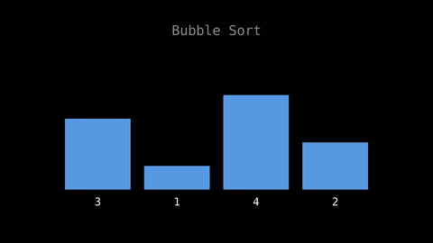
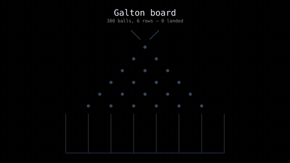
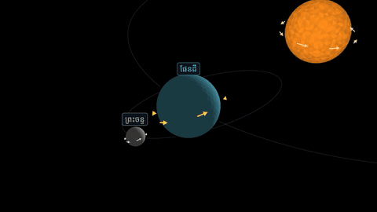

# Codimate examples

Short animations that explain algorithms, mathematics, and physics with Python.
[Codimate](https://github.com/darhnoel/codimate) · [Docs](https://darhnoel.github.io/codimate/)

## See what Codimate can do

### Bubble sort



Watch each value travel with its bar. [Code](computing/bubble_sort/main.py) · [Notes](computing/bubble_sort/README.md)

### Galton board



Simulate hundreds of balls and see their landings form a bell curve. [Code](mathematics/galton_board/main.py) · [Notes](mathematics/galton_board/README.md)

### Orbits



Follow the Earth and Moon, then pull back to see the Sun. [Code](physics/orbits/main.py) · [Notes](physics/orbits/README.md)

## Run an example

```bash
git clone https://github.com/darhnoel/codimate-examples
cd codimate-examples
python3 -m venv .venv
.venv/bin/pip install -r requirements.txt
# Install FFmpeg separately; formula examples also need Typst.
.venv/bin/python computing/bubble_sort/main.py
```

The video is written to `results/bubble_sort.mp4`.

Browse [computing](computing/), [mathematics](mathematics/), [physics](physics/), and [showcase](showcase/).
